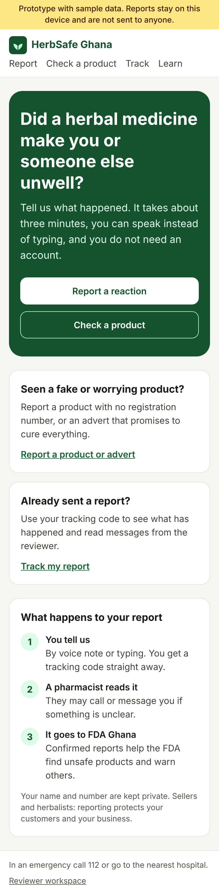
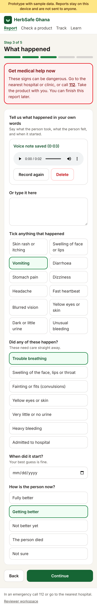
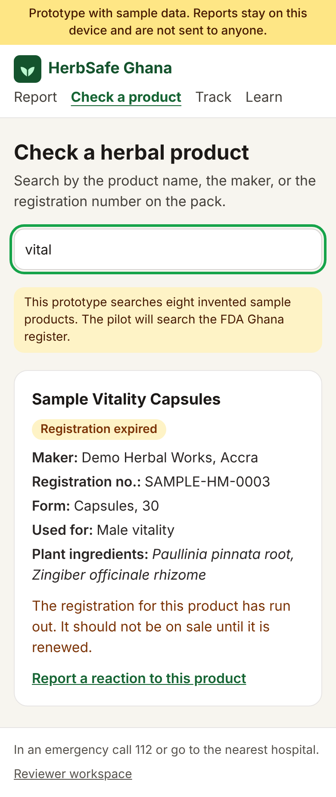
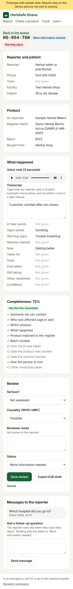

# HerbSafe Ghana

A phone-first website for reporting bad reactions to herbal medicines in Ghana, checking whether a herbal product is registered, and giving reviewers complete cases to pass to the Food and Drugs Authority (FDA Ghana).

**This is a clickable prototype.** All data is sample data, everything is stored in the browser only (IndexedDB), and nothing is sent to the FDA or anyone else. The products in the product checker are invented and their registration numbers are not real.

| Home | Report with voice note | Product check | Reviewer case |
| --- | --- | --- | --- |
|  |  |  |  |

## What the prototype does

- **Report a reaction** in five short steps with no account: who was affected, the product, what happened, a few details, send. The reporter can **record a voice note** (up to 2 minutes) instead of typing, add a photo of the pack, and gets a tracking code. A half-finished report is kept if the page is closed.
- **Urgent-care advice** appears as soon as a warning sign (for example trouble breathing or yellow eyes) is ticked.
- **Check a product** against a product register (eight invented sample products for now).
- **Report a suspicious product or advert** with a shorter form.
- **Track a report** by code and read the reviewer's follow-up questions.
- **Reviewer workspace** (`#/reviewer`): queue sorted with warning signs first, completeness score, voice note playback with a transcript box, seriousness and WHO-UMC causality, follow-up messages, CSV export, and an E2B(R3) field-map draft per case.

## Not built yet

- A server, database, accounts and real reviewer login.
- The real FDA Ghana product register.
- Sending acknowledgements by SMS, and submitting cases to the FDA.
- Automatic transcription and local languages (planned through the Khaya AI API).
- Offline service worker. The app has a web manifest so it can be added to a phone's home screen, but it needs a connection to load.
- A schema-valid E2B(R3) ICSR message. The current export lists the report against E2B(R3) data element numbers for a reviewer to check.

## Run it

```bash
npm install
npm run dev      # local development
npm test         # unit tests
npm run lint
npm run build    # static site in dist/
```

Voice notes need a secure context: `localhost` or an `https://` address.

The build uses relative paths and hash routing, so `dist/` works on any static host. `.github/workflows/pages.yml` deploys it to GitHub Pages on each push to `main` once Pages is set to "GitHub Actions" in the repository settings.

## Layout

- `src/pages` — screens (`Report.tsx` is the guided report; `reviewer/` is the workspace)
- `src/components` — shared pieces, including `VoiceRecorder.tsx`
- `src/lib` — data types, sample data, storage, completeness scoring, exports, tests

Stack: React, TypeScript, Vite, Tailwind CSS.
